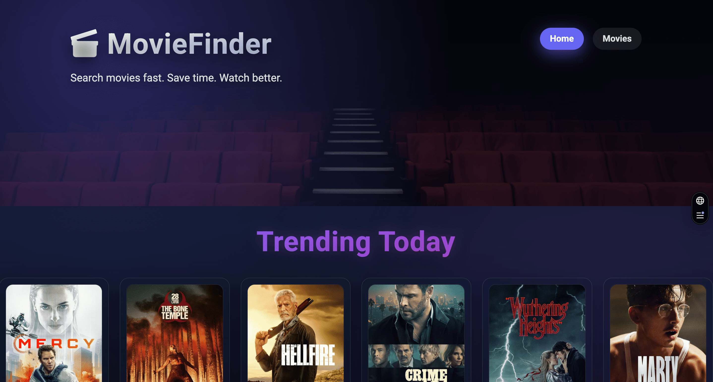
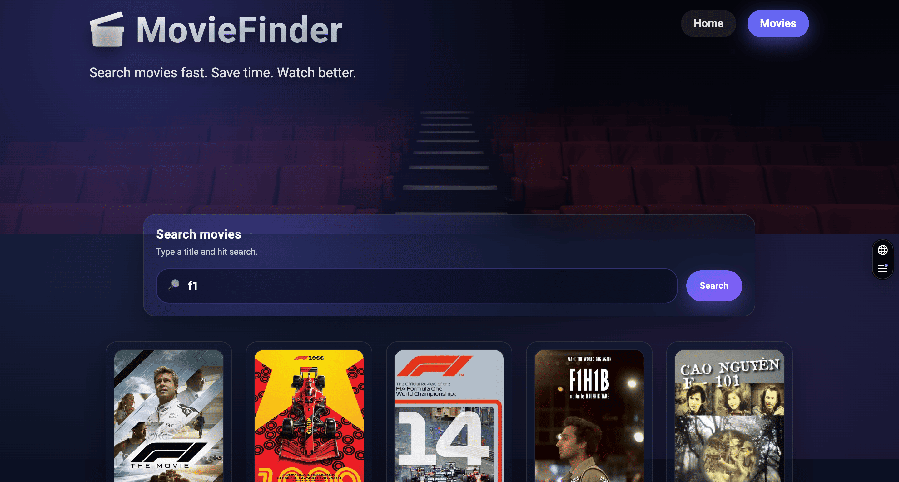
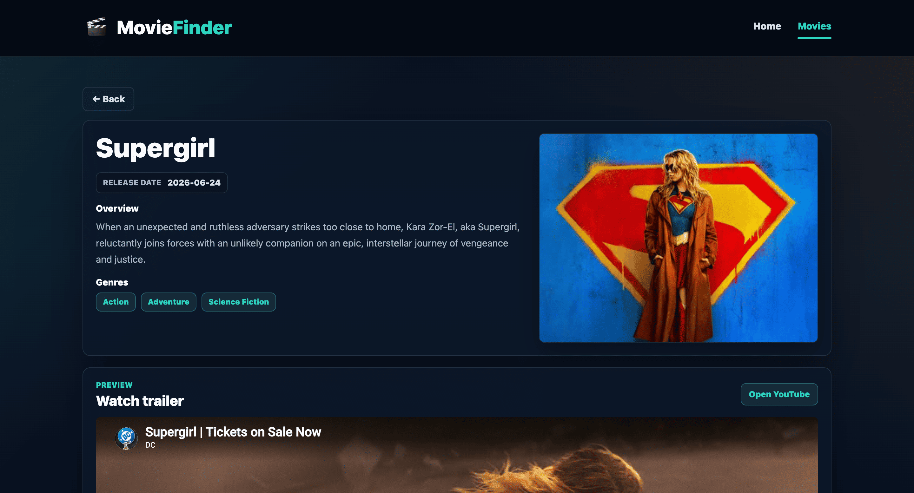

# MovieFinder

MovieFinder is a responsive React application for discovering movies, browsing the catalog, and viewing detailed movie information from The Movie Database API. The project focuses on clean routing, readable component structure, API-driven UI states, and a polished responsive interface.

## Live Demo

[View the deployed app](https://movie-finder-ebon-zeta.vercel.app/)

## Preview

### Home



### Search and Filters



### Movie Details



## Key Features

- Browse trending movies on the home page
- Search movies by title after submitting the search form
- Filter the catalog by genre and release year
- Keep search, filter, and pagination state in URL query params
- Open detailed movie pages with overview, release date, genres, cast, reviews, and trailer
- Navigate nested routes for cast and reviews
- Display loading, empty, and error states
- Use responsive layouts with consistent breakpoints for mobile, tablet, and desktop

## Tech Stack

- React 19
- React Router
- Vite
- Axios
- CSS Modules
- Lucide React
- React Spinners
- The Movie Database API
- Vercel

## Technical Highlights

- Route-based architecture with lazy-loaded pages
- Reusable movie list, loader, navigation, footer, cast, and reviews components
- Centralized API service layer for TMDB requests
- URL-driven filters and pagination for shareable search results
- Explicit search form submit to avoid unnecessary API requests while typing
- CSS Modules with shared design tokens and consistent `768px` / `1024px` breakpoints
- Accessible loading indicators and semantic page structure
- Basic Vitest and Testing Library coverage for reusable UI and helper logic

## Project Structure

```text
src
|-- components
|   |-- Footer
|   |-- Loader
|   |-- MovieCast
|   |-- MovieList
|   |-- MovieReviews
|   `-- Navigation
|-- pages
|   |-- HomePage
|   |-- MovieDetailsPage
|   |-- MoviesPage
|   `-- NotFoundPage
|-- services
|   `-- api.jsx
|-- test
|-- App.jsx
|-- App.css
|-- index.css
`-- main.jsx
```

## Getting Started

### Requirements

- Node.js 24 (used in CI)
- TMDB read access token

### Installation

```bash
git clone https://github.com/Anastasiia-git/MovieFinder.git
cd MovieFinder
npm install
```

Create a `.env` file in the project root. You can copy `.env.example` and replace the placeholder token:

```bash
VITE_TMDB_TOKEN=your_tmdb_read_access_token
```

Start the development server:

```bash
npm run dev
```

## Available Scripts

```bash
npm run dev
npm run build
npm run lint
npm run test
npm run preview
```

## CI/CD

GitHub Actions runs the [CI workflow](.github/workflows/ci.yml) on every push,
on pull requests targeting `main`, and on manual dispatch. Using Node.js 24
and the committed lockfile, it runs:

1. `npm ci`
2. `npm run lint`
3. `npm test`
4. `npm run build`

The workflow caches npm downloads, cancels superseded runs for the same ref,
and uses read-only repository permissions. Tests mock the TMDB API, so CI
does not need a TMDB token. Its build is a validation build, not a deployment.

Deployment uses the existing Vercel Git integration: branch pushes create
preview deployments, and changes to the production branch publish the live
app. Keep `VITE_TMDB_TOKEN` configured in Vercel for both Preview and Production;
the GitHub workflow does not change those settings or deploy its build output.

To require passing CI before merging, configure a GitHub branch protection
rule or ruleset for `main` after the first successful workflow run. Require
pull requests and the `Lint, test, and build` status check. This repository
file does not configure branch protection; Vercel deployments and CI otherwise
run independently, so a direct push to the production branch can deploy even
when CI fails.

## What This Project Demonstrates

- Building a production-style React SPA with client-side routing
- Fetching and normalizing REST API data
- Managing async loading, empty, and error states
- Preserving UI state through URL search params
- Creating a responsive interface with reusable CSS patterns
- Testing small pieces of UI and reusable logic
- Keeping code organized into small, readable modules

## Future Improvements

- Add a favorites or watchlist feature
- Add skeleton loaders for movie cards
- Add broader integration tests for the full search flow
- Add sorting by rating, popularity, and release date

## Author

Anastasiia Totska

[GitHub](https://github.com/Anastasiia-git)
